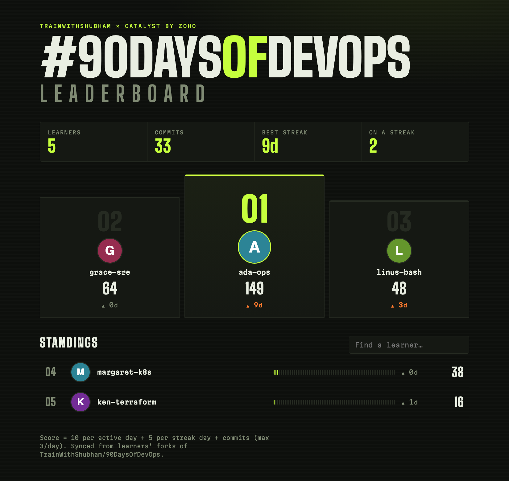
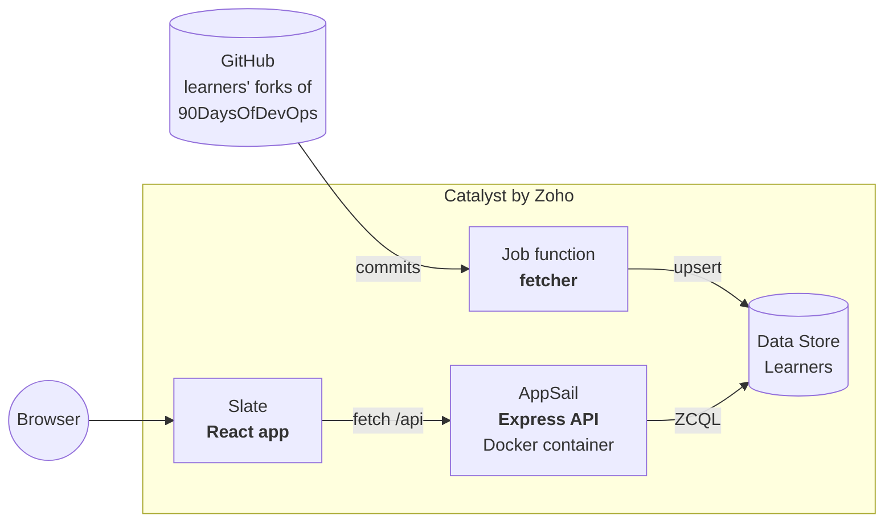

<div align="center">

# #90DaysOfDevOps Leaderboard

**A live leaderboard for the #90DaysOfDevOps community, built on [Catalyst by Zoho](https://catalyst.zoho.com).**
It reads learners' GitHub activity, stores it, and ranks who is consistent and who is on a streak.




*Screenshot uses the built-in demo data, not real learners.*

</div>

---

## Why this repo exists

AI agents can write an app in minutes. Getting it safely to production is the hard part: hosting, a database, containers, a pipeline, and a person deciding what goes live.

This project is a complete, real example of that path on one platform:

- an **AI coding agent** builds in the **Development** environment only,
- **CI** tests every push,
- the backend ships as a **Docker container** on AppSail, the frontend on Slate, the data in Data Store,
- a **human approves** before anything reaches Production.

It is the demo repo for the *"AI Agent se Production tak"* video from **TrainWithShubham**.

**New to Catalyst?** Read [LEARN.md](LEARN.md), a guide to the core concepts and main services that uses this repo as its worked example.

## How it works



1. The **fetcher** (a Catalyst Job function) finds active forks of [`TrainWithShubham/90DaysOfDevOps`](https://github.com/TrainWithShubham/90DaysOfDevOps), takes each learner's own commits, scores them, and upserts one row per learner.
2. The **API** (Express in a Docker container on AppSail) reads those rows and serves the ranking.
3. The **frontend** (React + Vite on Slate) renders the podium, stats and standings.

### Scoring

| Signal | Points |
| --- | --- |
| Each active day (a day with at least one commit) | 10 |
| Each day of your longest streak | 5 |
| Each commit, up to 3 per day | 1 |

Days are IST calendar days. A streak stays alive through yesterday, so it only resets after a full missed day.

## Quick start (no Catalyst account needed)

The API ships with an in-memory store, so you can run the whole app locally.

```bash
# terminal 1: API on :9000 with demo data
cd backend
npm ci
npm run dev

# terminal 2: frontend on :5173 (proxies /api to :9000)
cd frontend
npm ci
npm run dev
```

Open <http://localhost:5173>.

## Tests

```bash
(cd backend && npm test)            # API, schema checks
(cd frontend && npm test)           # components, filtering, error state
(cd functions/fetcher && npm test)  # scoring and streak logic
```

## Deploy to Catalyst

> **Students:** sign up through [catalyst.zoho.com/students](https://catalyst.zoho.com/students) to use Catalyst for free.

**Prerequisites:** a Catalyst project, Node 20+, Docker, and the CLI (`npm i -g zcatalyst-cli`).

### 1. Log in and link your project

```bash
catalyst login
catalyst init --org <your-org> -p <your-project-id> -ni   # creates .catalystrc
```

Create the project once in the [Catalyst console](https://console.catalyst.zoho.com) first. The CLI cannot create projects non-interactively.

### 2. Create the Data Store table

Catalyst can only create columns from the console, so [`backend/schema.json`](backend/schema.json) is the source of truth. In **Data Store → Create Table**, make a table named `Learners` (case-sensitive):

| Column | Type | Max length |
| --- | --- | --- |
| `login` | Var Char | 255 |
| `avatar_url` | Var Char | 255 |
| `total_commits` | Int | |
| `active_days` | Int | |
| `current_streak` | Int | |
| `longest_streak` | Int | |
| `score` | Int | |
| `last_active` | Var Char | 255 |
| `days` | Text | |

Don't add `ROWID`, `CREATORID`, `CREATEDTIME` or `MODIFIEDTIME`; Catalyst adds them.

### 3. Deploy the three tiers

```bash
# Fetcher (Job function)
catalyst deploy --only functions:fetcher -ni

# API: build for linux/amd64 (AppSail rejects ARM images), then deploy the container
docker build --platform linux/amd64 -t leaderboard-api:v1 backend
catalyst deploy appsail --name leaderboard-api --source docker://leaderboard-api:v1 --port 9000 -ni

# Frontend: bake in the API URL, point Slate at this checkout, deploy
echo "VITE_API_BASE=https://<your-appsail-url>" > frontend/.env.production
node scripts/relink-slate.js
catalyst deploy slate leaderboard-web -ni
```

The AppSail URL is printed by the deploy and looks like `https://leaderboard-api-<zaid>.development.catalystappsail.<dc>`. A fresh container can take about a minute to start.

### 4. Check that it works

```bash
sh scripts/smoke.sh https://<your-appsail-url>
```

It checks `/api/health`, `/api/health/schema` (does the table match `schema.json`?) and `/api/leaderboard`, retrying while the container starts.

### 5. Load the first data

Run the fetcher once against your Development environment:

```bash
# The CLI needs a Node 20 binary for this local run
catalyst config:set node20.bin=$(npx -y node@20 -p "process.execPath")
MAX_FORKS=15 catalyst functions:execute fetcher --key test_job -ni
```

For regular syncs, the `fetcher` function needs a **job pool** and a **cron schedule**. They are defined in [`infra/project-template.json`](infra/project-template.json): a pool named `leaderboard_sync` and a cron job `sync_leaderboard` that runs `*/30 * * * *` (Asia/Kolkata). See [Infrastructure as code](#infrastructure-as-code).

## Infrastructure as code

[`infra/project-template.json`](infra/project-template.json) is a Catalyst IaC template, exported with `catalyst iac:export`. It describes the `fetcher` function settings, the `Learners` table and its columns, the job pool, and the 30-minute cron schedule.

- **It creates a new project.** `catalyst iac:import` builds a fresh project from the template; it does not update an existing one. Use it to stand the whole setup up again, or to review what the schedule is.
- **Not covered:** AppSail and Slate do not appear in the export. Deploy them with the commands above.
- **Not yet tested:** the template comes from a real export, but `iac:import` has not been run against it.
- **Changing the schedule:** edit it in the console (Job Scheduling), then run `catalyst iac:export -ni` and `catalyst iac:status export` to refresh the file.

## CI/CD

[`.github/workflows/deploy.yml`](.github/workflows/deploy.yml) runs on every push to `main`:

```
test (3 in parallel) → deploy to Development → smoke test → human approval → Production
```

| Where | Name | Purpose |
| --- | --- | --- |
| Secret | `CATALYST_TOKEN` | CLI token (`catalyst token:generate`) |
| Variables | `CATALYST_ORG`, `PROJECT_ID` | Where to deploy |
| Variables | `DEV_API_URL`, `PROD_API_URL` | AppSail URLs baked into the Slate build |
| Environment | `production` | Add a **required reviewer**: the run pauses there until they approve |

The deploy builds the same Docker image as the manual steps above. The `deploy-prod` job is skipped until `PROD_API_URL` is set, so create the Production environment in the Catalyst console first.

> **Catalyst Pipelines version.** [`catalyst-pipelines.yaml`](catalyst-pipelines.yaml) is the same flow for Catalyst's own Pipelines service. It has not been run: the Pipelines page was not available in the console used to build this repo. The GitHub Actions workflow above is the one to use.

## API

| Endpoint | Description |
| --- | --- |
| `GET /api/health` | Liveness and which store is active |
| `GET /api/health/schema` | `200` if the table matches `schema.json`, `503` with the missing columns otherwise |
| `GET /api/leaderboard?limit=50` | Ranked learners (max 200) |
| `GET /api/learners/:login` | One learner, including their active days |
| `GET /api/stats` | Cohort totals |

## Configuration

| Where | Variable | Default | Meaning |
| --- | --- | --- | --- |
| API | `STORE` | Data Store | Set to `memory` for demo data |
| API | `CORS_ORIGIN` | `*` | Allowed browser origin |
| API | `X_ZOHO_CATALYST_LISTEN_PORT` / `PORT` | `9000` | AppSail injects the first |
| Fetcher | `GITHUB_TOKEN` | none | Avoids the 60 requests/hour anonymous limit |
| Fetcher | `UPSTREAM_REPO` | `TrainWithShubham/90DaysOfDevOps` | Repo whose forks are scanned |
| Fetcher | `COHORT_START` | `2026-01-23` | Commits before this date are ignored |
| Fetcher | `MAX_FORKS` | `300` | Forks processed per run |
| Frontend | `VITE_API_BASE` | same origin | API URL, set at build time |

## Project structure

```
.
├── backend/               Express API, Dockerfile, schema.json, store implementations
├── frontend/              React + Vite app deployed to Slate
├── functions/fetcher/     Job function: GitHub → scores → Data Store
├── infra/                 Catalyst IaC template: schedule, job pool, table
├── scripts/
│   ├── smoke.sh           Post-deploy health and schema check
│   └── relink-slate.js    Fixes the absolute Slate path catalyst.json records
├── catalyst.json          Catalyst project resources
└── catalyst-pipelines.yaml
```

## Troubleshooting

| Symptom | Cause and fix |
| --- | --- |
| `/api/health/schema` returns `503` | The table is missing columns. The response lists them; add them in the console. |
| AppSail answers `AppSail is disabled` or `Execution failed` right after a deploy | The new container is still starting. Wait a minute and retry. |
| `catalyst functions:execute` says Node v20 is missing | Run `catalyst config:set node20.bin=<path to a Node 20 binary>`. |
| Slate shows "Can't reach the leaderboard API" | `VITE_API_BASE` was empty or wrong at build time. Rebuild and redeploy. |
| AppSail rejects the image | It must be `linux/amd64`. Build with `--platform linux/amd64`. |

## Take the challenge

Fork this repo, add a feature, deploy it on Catalyst, and share it on LinkedIn with **#90DaysOfDevOps** and **#TrainWithShubham**.

Ideas: a weekly leaderboard, a per-learner heatmap page, streak badges, a Slack or Discord digest, or Catalyst Authentication so learners can claim their profile.

## Contributing

Issues and pull requests are welcome. Please run all three test suites before opening a PR.

## Built with

Written by an AI coding agent ([Claude Code](https://claude.com/claude-code)) and shipped by a human: the agent builds in Development, and a person decides what reaches Production.

## License

[MIT](LICENSE) © TrainWithShubham
