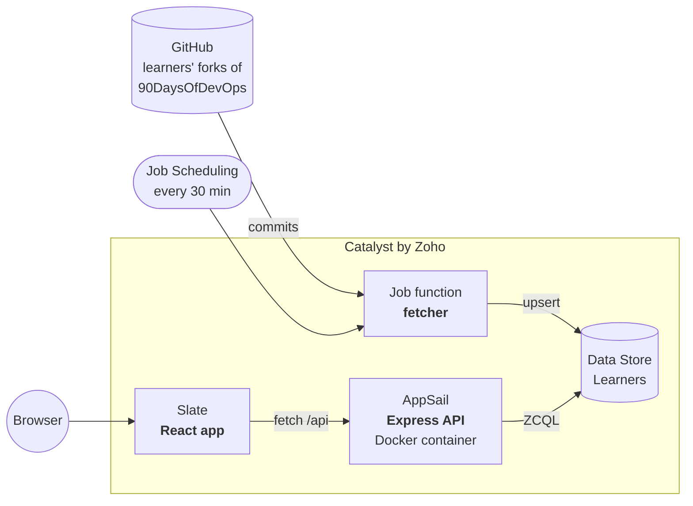

<div align="center">

# #90DaysOfDevOps Leaderboard

**Who is consistent, and who is on a streak? A three-tier app on [Catalyst by Zoho](https://catalyst.zoho.com), built by an AI agent and shipped by a human.**

[**Live site**](https://90daysofdevops-leaderboard.onslate.in) · [**Deploy your own**](DEPLOY.md) · [**Learn Catalyst**](LEARN.md) · [**Take the challenge**](#take-the-challenge)


*The live leaderboard, built from learners' public forks.*

</div>

## Run it in 60 seconds

No Catalyst account needed. The API ships with demo data.

```bash
# terminal 1: API on :9000
cd backend && npm ci && npm run dev

# terminal 2: app on :5173
cd frontend && npm ci && npm run dev
```

Open <http://localhost:5173>. Tests: `npm test` in `backend/`, `frontend/` and `functions/fetcher/`.

## How it works



The **fetcher** finds active forks of [`TrainWithShubham/90DaysOfDevOps`](https://github.com/TrainWithShubham/90DaysOfDevOps), scores each learner's commits and upserts one row each. The **API** serves the ranking. The **frontend** draws the podium and standings.

| Signal | Points |
| --- | --- |
| Each active day (at least one commit) | 10 |
| Each day of your longest streak | 5 |
| Each commit, up to 3 per day | 1 |

Days are IST calendar days. A streak stays alive through yesterday.

## What this repo teaches

The demo repo for the *"AI Agent se Production tak"* video from **TrainWithShubham**. Every service below is used by real code here.

| You want to learn | Catalyst service | Where it lives |
| --- | --- | --- |
| Store data and query it | **Data Store** | [`backend/schema.json`](backend/schema.json) |
| Run short background code | **Functions** (Job) | [`functions/fetcher/`](functions/fetcher) |
| Run an always-on API in a container | **AppSail** | [`backend/Dockerfile`](backend/Dockerfile) |
| Host a React frontend | **Slate** | [`frontend/`](frontend) |
| Run code on a timer | **Job Scheduling** | [`infra/project-template.json`](infra/project-template.json) |
| Test, deploy and gate Production | CI/CD | [`deploy.yml`](.github/workflows/deploy.yml), [`catalyst-pipelines.yml`](catalyst-pipelines.yml) |
| Let an AI agent work safely | **MCP + CLI** | [docs/BUILD.md](docs/BUILD.md#working-with-an-ai-agent) |

## How it ships

One delivery flow, written for two runners. Pick the one that matches where your code lives:

```
push to main → test (backend, fetcher, frontend) → deploy to Development → smoke test → [human approval → Production]
```

| Runner | File | Use it when | Production step |
| --- | --- | --- | --- |
| **Catalyst Pipelines** | [`catalyst-pipelines.yml`](catalyst-pipelines.yml) | You want CI/CD inside Catalyst, with no extra accounts | Not wired up yet |
| **GitHub Actions** | [`.github/workflows/deploy.yml`](.github/workflows/deploy.yml) | Your team already works in GitHub | Waits for a `production` reviewer |

Both run the same tests and the same [`scripts/smoke.sh`](scripts/smoke.sh), and both deploy with the Catalyst CLI. Development is verified end to end on each. The Catalyst Pipelines run, all stages green:

<p>


</p>

[GitHub Actions run screenshot](docs/screenshots/ci-run.png) · Setup for both is in [DEPLOY.md](DEPLOY.md). Known gaps are in [docs/STATUS.md](docs/STATUS.md).

## Take the challenge

Fork this repo, add a feature, deploy it on Catalyst, and share it on LinkedIn with **#90DaysOfDevOps** and **#TrainWithShubham**.

Ideas: a weekly leaderboard, a per-learner heatmap page, streak badges, a Slack or Discord digest, Catalyst Authentication so learners can claim their profile, or more forks per sync.

> **Students:** sign up through [catalyst.zoho.com/students](https://catalyst.zoho.com/students) to use Catalyst for free.

## Docs

| Read | For |
| --- | --- |
| [DEPLOY.md](DEPLOY.md) | Your own copy, every command in order |
| [LEARN.md](LEARN.md) | Catalyst concepts, gotchas and exercises |
| [docs/BUILD.md](docs/BUILD.md) | The build chapters, Dev vs Production, IaC, AI agent, troubleshooting |
| [docs/REFERENCE.md](docs/REFERENCE.md) | API, configuration, project structure |
| [docs/THEME.md](docs/THEME.md) | The UI theme and its contrast choices |
| [docs/STATUS.md](docs/STATUS.md) | What is and is not proven |

Issues and pull requests are welcome; run all three test suites first. Written by an AI coding agent ([Claude Code](https://claude.com/claude-code)); a person decides what reaches Production. [MIT](LICENSE) © TrainWithShubham
