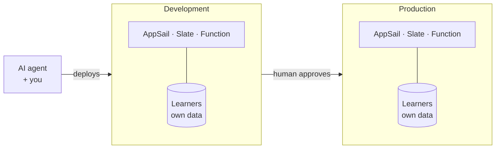

# Build it on Catalyst: the chapters

> Moved out of the README. For a single checklist to run on your own fork, use [DEPLOY.md](../DEPLOY.md). For concepts, see [LEARN.md](../LEARN.md).

The chapters follow the video. Each one has the commands, what you should see, and the traps we actually fell into. For a single start-to-finish checklist you can follow on a fork, use [DEPLOY.md](../DEPLOY.md).

> **Students:** sign up through [catalyst.zoho.com/students](https://catalyst.zoho.com/students) to use Catalyst for free.

### 1. Set up: account, CLI, project

```bash
npm i -g zcatalyst-cli
catalyst login
catalyst project:list          # note your org and project ID
catalyst init --org <your-org> -p <your-project-id> -ni
```

`init` writes `.catalystrc` (gitignored). The CLI cannot create a project non-interactively, so create it once in the [console](https://console.catalyst.zoho.com).

> **Trap: data center.** Your account lives in one data center (this project: **India**) and every URL depends on it: `.catalystappsail.in`, `.onslate.in`. The CLI defaults to US. Pass `--dc <your-dc>` when you use a token (in CI this is the `CATALYST_DC` variable), and check the suffix of the URL a deploy prints.

### 2. Connect the AI agent: MCP and Agent Skills

Catalyst's MCP server is per data center. For India, point the plugin at `https://catalyst.zohomcp.in/mcp/message` (the plugin's `switch-dc` command does this), restart your agent, then approve the browser login.

> **Trap: the OAuth callback.** After you approve, the browser redirects to `http://localhost:<port>/callback?...` and shows "This site can't be reached". That is normal. Copy the **full URL from the address bar** and give it to your agent in the **same session**. If you restart first, the login state is gone and you must start over.

Check the agent and the CLI agree on the project before you let the agent change anything: ask for the project by ID through the MCP and compare it with `.catalystrc`.

### 3. The database: Data Store

[`backend/schema.json`](../backend/schema.json) is the source of truth. In the console, **Data Store → Create Table** named `Learners` (case-sensitive):

| Column | Type | Max length |
| --- | --- | --- |
| `login` | Var Char | 255 |
| `avatar_url` | Var Char | 255 |
| `total_commits` | Int | |
| `active_days` | Int | |
| `current_streak` | Int | |
| `longest_streak` | Int | |
| `score` | Int | |
| `last_active` | Var Char | 255 |
| `days` | Text | |

Do not add `ROWID`, `CREATORID`, `CREATEDTIME` or `MODIFIEDTIME`; Catalyst adds them.

> **Trap: a table is not a schema.** Our first deploy returned `Unknown Table Learners or Unknown Column login` because the table existed with only the system columns. That is why the API has `/api/health/schema`: it compares the live table with `schema.json` and returns `503` with the missing columns.

### 4. The backend on AppSail, as a Docker container

```bash
# AppSail only accepts linux/amd64. On an Apple Silicon Mac this flag is required.
docker build --platform linux/amd64 -t leaderboard-api:v1 backend
catalyst deploy appsail --name leaderboard-api --source docker://leaderboard-api:v1 --port 9000 -ni
```

You should see `✔ Catalyst AppSail Deploy completed successfully` and the service URL. The app must listen on the port in `X_ZOHO_CATALYST_LISTEN_PORT`; [`server.js`](../backend/src/server.js) reads it.

> **Trap: the first minute.** A fresh container takes about a minute to start. Until then you will see `AppSail is disabled` or `Execution failed`. Wait, then retry.
>
> **Trap: a crash on start.** One image crashed with `Cannot find module '../schema.json'` because the Dockerfile did not copy it. Run the image locally before you deploy it: `docker run -p 9000:9000 -e STORE=memory leaderboard-api:v1`.

### 5. The frontend on Slate

```bash
echo "VITE_API_BASE=https://<your-appsail-url>" > frontend/.env.production
node scripts/relink-slate.js
catalyst deploy slate leaderboard-web -ni
```

> **Trap: build-time variables.** Vite bakes `VITE_API_BASE` into the JavaScript while it builds. If it was empty or wrong then, the live site says "Can't reach the leaderboard API" until you rebuild and redeploy; editing it afterwards does nothing.
>
> **Why `relink-slate.js`?** The CLI records the frontend path in `catalyst.json` as an absolute path. The script rewrites it for your machine, so the committed file can stay portable.

### 6. The sync: a Job function and Job Scheduling

```bash
catalyst deploy --only functions:fetcher -ni
```

The schedule is a **job pool** (where jobs run) plus a **cron** (when). Both are written down in [`infra/project-template.json`](../infra/project-template.json): pool `leaderboard_sync`, cron `sync_leaderboard`, `*/30 * * * *` in `Asia/Kolkata`.

> **Trap: names.** A job pool name allows only letters, numbers and underscores. `leaderboard-sync` was rejected; `leaderboard_sync` worked.
>
> **Trap: IDs differ per environment.** When Production got its own copy of the pool, it also got a new ID. A manual run that used the Development pool's ID reported `FAILURE`; use the pool ID of the environment you are in.
>
> **Trap: the rate limit.** Without a `GITHUB_TOKEN`, GitHub allows 60 requests an hour, so keep `MAX_FORKS` low (we used 15) or add a token.

Load the first data by hand to check it works:

```bash
catalyst config:set node20.bin=$(npx -y node@20 -p "process.execPath")   # the local run needs a Node 20 binary
MAX_FORKS=15 catalyst functions:execute fetcher --key test_job -ni
```

### 7. CI/CD: test, deploy, smoke, approve

[`.github/workflows/deploy.yml`](../.github/workflows/deploy.yml) runs on every push to `main`:

```
test (3 in parallel) → deploy to Development → smoke test → human approval → Production
```

| Where | Name | Purpose |
| --- | --- | --- |
| Secret | `CATALYST_TOKEN` | CLI token from `catalyst token:generate` |
| Variables | `CATALYST_ORG`, `PROJECT_ID` | Where to deploy |
| Variable | `CATALYST_DC` | Your data center: `us`, `eu`, `in` or `au` (defaults to `us`) |
| Variable | `PROD_API_URL` | Production AppSail URL; `deploy-prod` is skipped until it is set |
| Variable | `DEV_API_URL` | Optional fallback; the deploy reads the AppSail URL from its own output |
| Environment | `production` | Add a **required reviewer**: the run pauses there until they approve |

The smoke test is a script you can run anywhere:

```console
$ sh scripts/smoke.sh https://<your-appsail-url>
ok   /api/health  {"status":"ok","store":"catalyst-datastore"}
```

It also checks `/api/health/schema` and `/api/leaderboard`, retrying while the container starts.

> **Trap: your token is a secret.** `catalyst token:generate` prints a full-access token. Run it in your own terminal, put it straight into the secret, and never paste it into a chat or a log. Revoke old ones with `catalyst token:revoke <id>`.
>
> **GitHub Actions or Catalyst Pipelines?** Both run the same flow. GitHub Actions deploys on every push to `main`. [`catalyst-pipelines.yml`](../catalyst-pipelines.yml) runs on Catalyst Pipelines, which needs its own variables (see the comment at the top of the file); the default image there has Node 18 and no `catalyst` command, so the file installs Node 20 and a pinned CLI itself.

### 8. Promote to Production, with a human in the loop

1. In the Catalyst console, create the **Production** environment and promote your Development services to it.
2. Deploy the frontend to Production with its own API URL: `catalyst deploy slate leaderboard-web --production -ni`.
3. Run the sync once in Production, because the table starts empty.
4. Set the repo variable `PROD_API_URL`. From then on `deploy-prod` waits for the `production` reviewer.

### 9. Logs, monitoring and debugging

When something breaks, check in this order: the service's own status, then its logs, then the dependency behind it.

```bash
curl -s https://<your-appsail-url>/api/health/schema    # is the table what the code expects?
curl -s https://<your-appsail-url>/api/stats            # is there any data at all?
```

A real example from this project: after the first run in Production, both sync jobs reported `FAILURE` even though rows had been written. The likely cause is GitHub's rate limit stopping the job part-way, but we have not confirmed it, because the function's logs came back empty when queried through the API. Use the **Logs** page in the console for the real evidence.


## Development vs Production

Catalyst gives a project separate **environments**. Each has its own URLs, its own data and its own copy of every service.



What that looked like in this project:

| | Development | Production |
| --- | --- | --- |
| API URL | `leaderboard-api-<id>.development.catalystappsail.in` | `leaderboard-api-<id>.catalystappsail.in` |
| Slate URL | `leaderboard-web-<hash>.onslate.in` | a different `<hash>` |
| Learners right after promotion | 13 | **0**: the table existed but had no rows |

Promoting to Production copied the services and the empty table, not the data. We had to run the sync in Production on its own. The Slate app was not promoted either and needed its own `catalyst deploy slate --production`.

## Infrastructure as code

[`infra/project-template.json`](../infra/project-template.json) is a Catalyst IaC template, exported with `catalyst iac:export`. It describes the `fetcher` function settings, the `Learners` table and its columns, the job pool, and the 30-minute cron schedule.

- **It creates a new project.** `catalyst iac:import` builds a fresh project from the template; it does not update an existing one. Use it to stand the setup up again, or to review what the schedule is.
- **Not covered:** AppSail and Slate do not appear in the export. Deploy them with the commands above.
- **Not yet tested:** the template comes from a real export, but `iac:import` has not been run against it.
- **Refreshing it:** after you change something in the console, run `catalyst iac:export -ni`, then `catalyst iac:status export`, which asks before it downloads the zip.

## Working with an AI agent

The agent did the typing; a person made every decision that was hard to undo.

| The agent did | A person did |
| --- | --- |
| Wrote the Express API, the React app and the fetcher, with tests | Chose the project, data center and what to build |
| Built and ran the Docker image locally before deploying | Approved each browser login (MCP, CLI token) |
| Deployed to **Development** with the non-interactive CLI (`-ni`) | Created the Data Store table and its columns in the console |
| Created the job pool and cron through the MCP, then tested one run | Decided to promote to **Production** and clicked it |
| Wrote the CI workflow and fixed what broke | Held the secrets and the `production` approval |

Two limits we hit are worth knowing before you hand an agent your account:

- **`-ni` has holes.** Deleting a function remotely is refused in non-interactive mode, the CLI cannot create a project non-interactively, and columns can only be added in the console. Those need a person.
- **Expect a permission check on Production.** The first write to Production was blocked until it was approved explicitly. That is the behavior you want.

## Troubleshooting

| Symptom | Cause and fix |
| --- | --- |
| `/api/health/schema` returns `503` | The table is missing columns. The response lists them; add them in the console. |
| AppSail answers `AppSail is disabled` or `Execution failed` right after a deploy | The container is still starting. Wait a minute and retry. |
| AppSail rejects the image | It must be `linux/amd64`. Build with `--platform linux/amd64`. |
| The container exits with `Cannot find module` | A file is missing from the image. Run it locally with `docker run` first. |
| Slate shows "Can't reach the leaderboard API" | `VITE_API_BASE` was empty or wrong at build time. Rebuild and redeploy. |
| The production site loads but is empty | Production has its own data. Run the sync there. |
| `catalyst functions:execute` says Node v20 is missing | Run `catalyst config:set node20.bin=<path to a Node 20 binary>`. |
| A CLI call with a token fails or hits the wrong region | Add `--dc in` (or your data center). |
| MCP login ends on "This site can't be reached" | Paste the address-bar URL to the agent in the same session. |
| A job pool name is rejected | Use only letters, numbers and underscores. |
| A manual cron run says `FAILURE` in a new environment | Use that environment's own job pool ID. |
| The sync is slow or stops part-way | Set `GITHUB_TOKEN`, or lower `MAX_FORKS`. |
| `catalyst deploy slate` prints "Deploy is Live!" and then `HTTP Error: 400` | The site was already updated; this was a transient follow-up call. Re-run the job (`gh run rerun <id> --failed`). It passed on the second try here. |
